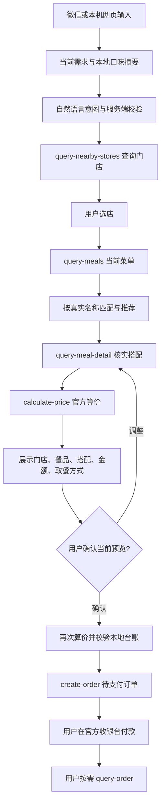

# 麦合拍 MaiMate · 麦当劳 MCP 接入说明

麦合拍是以个人微信为入口的到店点餐 Skill / 智能体，也提供本机网页。它把用户这次想吃什么、可纠正的口味记忆与门店当前菜单结合起来，完成选餐、搭配、官方算价、预览确认和官方收银台交接。

本文说明已经实现的调用链。早期开发报告中的探索方案，不代表当前接口或已交付功能。

## 实际使用的 Server

| 项目 | 配置 |
| --- | --- |
| 服务提供方 | 麦当劳中国官方 MCP Server |
| 服务地址 | `https://mcp.mcd.cn` |
| 传输方式 | Streamable HTTP |
| 协议版本 | 请求 `2025-06-18`，校验服务端协商结果 |
| 认证 | `Authorization: Bearer ${MCDONALD_MCP_KEY}` |
| 文档 | [官方 MCP 仓库](https://github.com/M-China/mcd-mcp-server)、[官方接入文档](https://open.mcd.cn/mcp/doc) |

脱敏连接示例见根目录 [mcp-config.example.json](mcp-config.example.json)。`${MCDONALD_MCP_KEY}` 只是环境变量占位符，不能作为真实凭证使用；不同宿主对占位符展开的支持不同，导入前需核对宿主文档。MaiMate 自身由后端从项目内 `.env` 或进程环境读取 `MCDONALD_MCP_KEY`，不直接加载此示例 JSON，也不会自动把示例文件中的字符串替换成密钥。

实现入口：[mcd_adapter.py](麦合拍MaiMate/maimate/scripts/mcd_adapter.py)。客户端执行 `initialize → notifications/initialized → tools/list → tools/call`，支持工具分页发现与 JSON / SSE 响应，保留协商的会话头，按实时 `inputSchema` 校验参数并检查业务成功标记。TLS 校验保持开启，不跟随携带认证头的跨地址重定向。

## 已接入主流程的 Tool

| Tool | 触发条件与用途 | 数据约束 |
| --- | --- | --- |
| `query-nearby-stores` | 用户提供城市、地标或授权定位后查询门店 | 使用真实返回的 `storeCode`；用户选择门店，不能默认选择搜索首项 |
| `query-meals` | 选店后读取当前门店菜单 | 只从返回的编码和名称中选餐；不使用 `frequent` 字段建画像 |
| `query-meal-detail` | 选中餐品后读取套餐轮次与特制选项 | 默认项、选配编码、特制 key 来自详情；必选项不明时先询问 |
| `calculate-price` | 选配完成、修改餐单以及提交前复核 | 以官方整数分总价为准，展示费用与可用 `takeWayList` |
| `create-order` | 用户看过当前预览并明确确认后创建待支付订单 | 写操作必须经过本地确认台账；模型输出不能授权 |
| `query-order` | 用户主动要求查询本次已知订单 | 使用已取得的 `orderId`；状态与取餐码来自官方返回 |
| `query-my-account` | 用户明确要求查询自己的积分 | 仅按需展示必要信息，不送入模型或口味记忆 |
| `query-my-coupons` | 用户明确要求查看自己的优惠券 | 不展示券码，不把账户资产作为推荐画像 |

其他发现到的工具不等于主流程已经使用。项目没有通过自动领券、历史订单扫描或会员购买来学习用户偏好。取消与其他高级写操作也不能绕过确认台账，不能把取消订单描述成独立退款接口。

## 从一句话到真实餐单

当前到店取餐使用 `orderType=1`、`beType=1`，不凭空生成门店编码、商品编码或取餐方式。实时门店 schema 需要城市与关键词；定位先由经用户授权的坐标反向解析，再查门店，不虚构经纬度查询参数。微信定位采用独立的一次性链接，后台设置端口不通过隧道公开。

千问 / DeepSeek 负责结构化意图理解，服务端执行真实工具调用。明确餐品名优先于模型推荐序号和历史喜好；简称匹配多个商品时需要用户选择，不能把缺货餐品替换成另一个套餐。菜单过长时，当前目标优先进入模型上下文。

## 越用越懂的记忆如何参与

麦当劳 MCP 提供门店、菜单、价格和订单能力；个人口味记忆由本项目本地实现，不能把它描述成麦当劳官方画像接口。

- 明确喜好：从用户主动表达中记录饮食标签与来源，可修改、单项删除、全部清除或关闭。
- 用户昵称：没有预置套餐昵称映射。“昵称就是餐品名”或“我要某餐品（即昵称）”必须在当前菜单核实唯一目标，才保存为该用户的定义。模型猜测不能写入事实。
- 选择与反馈：多次选餐是弱信号，不能冒充购买记录；餐后评价绑定最近选餐，同次可修正，最近90天逐渐降低影响。
- 推荐排序：本次明确要求优先，随后参考明确喜好、选择与反馈，提供可核对的推荐理由；这不是训练或自动修改模型。

实现见 [ordering_agent.py](麦合拍MaiMate/maimate/scripts/ordering_agent.py)、[dining_memory.py](麦合拍MaiMate/maimate/scripts/dining_memory.py)、[Skill](麦合拍MaiMate/maimate/SKILL.md)。

## 业务价值

到店时，用户可以沿用日常微信对话选餐，无需每次重新描述饮料和口味；抽象昵称通过实际使用沉淀，具体餐品仍由真实菜单约束。用户可以查看它“记住了什么”和“为什么推荐”，本次换口味不会被过去的习惯覆盖。点餐结果能走到官方待支付订单与官方收银台，形成可继续操作的业务链路。

## 确认、付款和隐私边界

下单前展示完整预览，用户明确确认后再次算价。价格、搭配、费用或预览有效性发生变化时，旧确认失效。写请求先原子记录为 `in_flight`；超时、响应缺失或崩溃留下未知结果时保持锁定，不自动重试或换会话绕过。

这是本地去重与确认约束；官方未承诺服务端幂等、库存预占或原子价格版本，客户端不声称具有这些保证。项目不具备自动代扣接口，付款由用户在官方页面完成。过敏、营养、备餐时间等不能根据餐品名推定。

真实凭证、微信绑定、偏好库、台账及日志留在项目内被忽略的运行目录。模型只接收必要的对话、菜单及口味摘要，不接收 MCP Token、微信凭证或账户资产明细。聊天仅在当前进程维护有限上下文，不把整段聊天写入长期记忆。详细说明见 [PRIVACY.md](PRIVACY.md)。

## 验证与复现

2026-10-24 的隔离回归测试共174项通过，覆盖真实编码约束、套餐选配、明确名称与错误模型序号冲突、昵称学习与删除、偏好隔离、算价变化、重复确认、过期预览、未知提交跨重启保护及定位监听器隔离。执行命令见根目录 [README.md](README.md#测试)。

真实 MCP 联调已验证工具发现、门店、菜单、详情与算价查询；一次工具发现返回35项，数量可能随官方服务更新。真实查询停在写入前，未为演示创建订单或付款。订单创建、付款交接与状态展示的自动化验证使用模拟服务，不能把模拟成功当作真实支付证明。[演示说明](docs/DEMO.md) 的截图也只使用合成数据。
