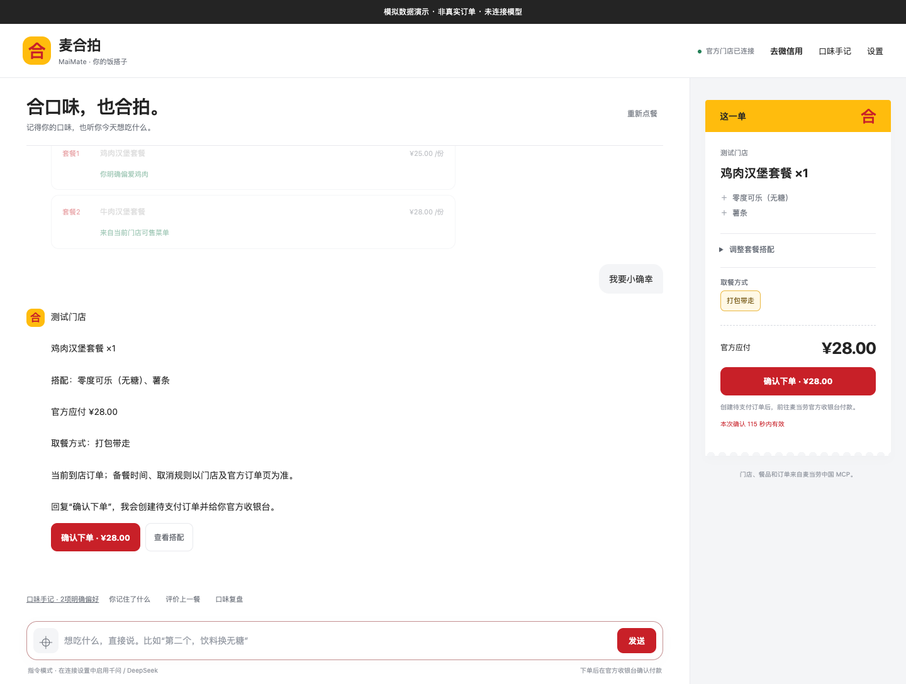
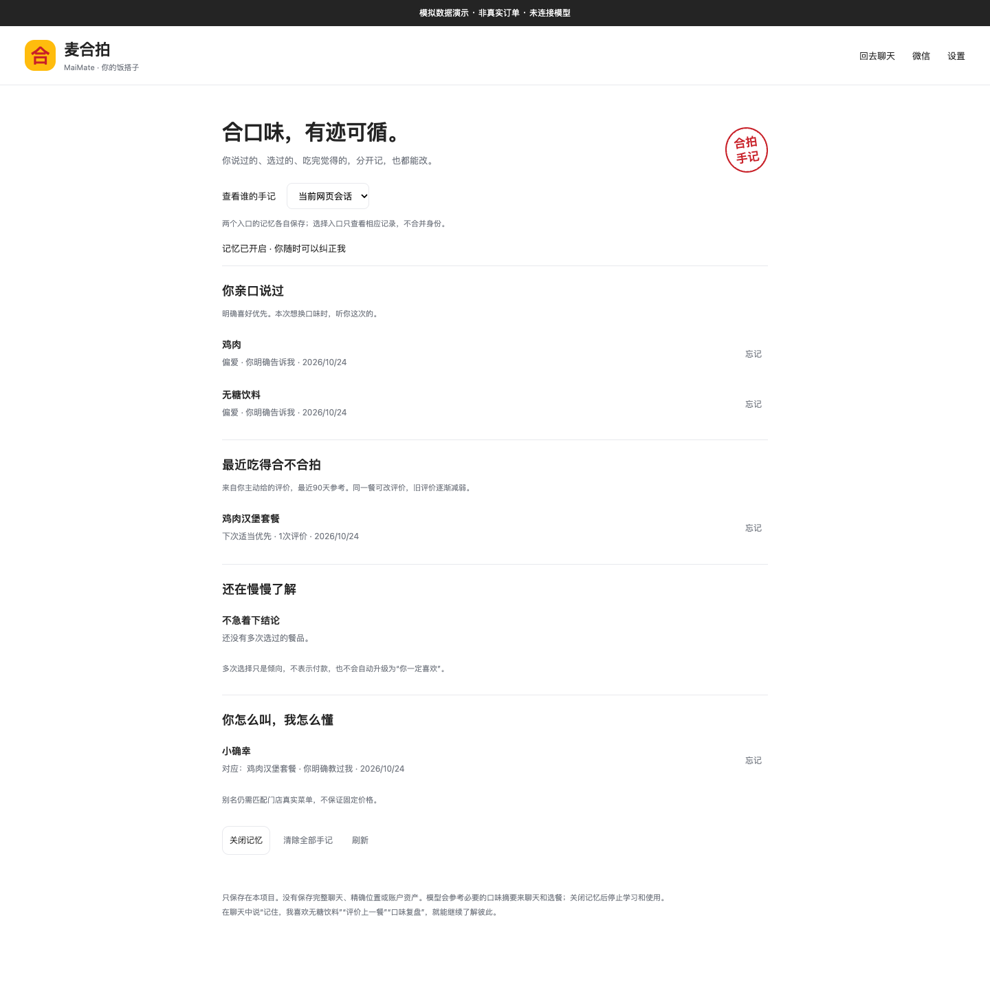
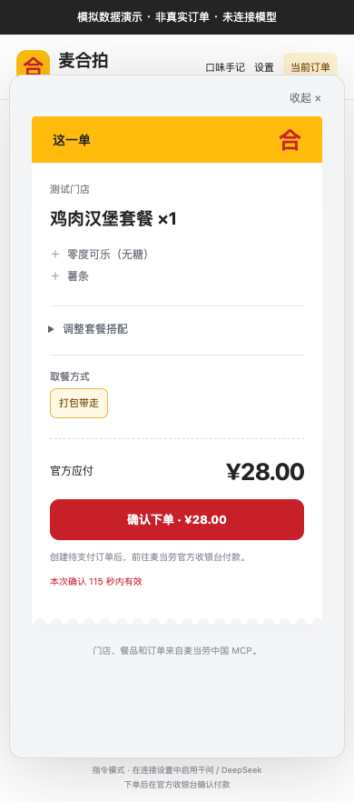

# 麦合拍 MaiMate · 演示与复现

麦合拍希望成为能记住口味、也能被纠正的点餐搭子。个人微信是日常入口，本机网页提供相同的点餐引擎与可查看的口味手记。

本页截图来自隔离的模拟服务，全部使用合成数据，图片内标有“模拟数据演示”。没有调用真实微信发送消息、没有创建真实订单，截图金额不代表任何真实门店报价。截图使用指令模式，完整自然语言对话需用户自行配置千问或 DeepSeek。

## 三分钟看完核心路径

1. **说口味**：“记住，我喜欢无糖饮料，也爱吃薯条。”保存的是结构化标签，可以查看和忘记。
2. **确定门店**：发城市和门店名，从真实 MCP 搜索结果中选店；不把首个结果当作默认门店。
3. **明确选餐**：说菜单里的完整名称，或让它推荐。简称有多个匹配时先选，不由旧推荐序号覆盖当前名称。
4. **教昵称**：选店后说“小确幸就是菜单中的餐品名”。目标经核实后才记住，之后可直接使用自己的叫法。没有内置套餐昵称映射。
5. **调整并预览**：选择真实可用的饮料、搭配与取餐方式，查看官方应付金额；变更后重新算价。
6. **明确确认**：回复“确认下单”才创建待支付订单，用户自己在官方收银台付款。演示和自动化测试以模拟服务代替真实写入。
7. **回来反馈**：“这餐好吃”“这餐一般”或“这餐不喜欢”。下一次推荐参考可查看的证据，而不是把一次选择永久当成偏好。

## 点餐与当前订单

聊天、少量候选和当前订单放在一起。门店、餐品、搭配、金额与取餐方式必须可核对，模型话术不能替代查询结果。模拟截图中的套餐和金额仅供展示布局。

## 口味手记

明确喜好、餐后反馈、选择倾向与个人昵称分开呈现，能够按入口查看、关闭和删除。推荐理由来自实际保存的证据；选择和反馈都不代表已付款。

## 手机布局

个人微信的扫码连接和收发需要真实绑定，公开材料不包含真实微信页面、绑定二维码或聊天记录。手机图展示的是本机网页的响应式布局，不冒充微信截图。

## 自行运行

按根目录 [README.md](../README.md#安装与启动) 创建项目内 Conda 环境、配置自己的麦当劳 MCP Token 并启动服务。配置模型后可使用自然语言；不配置模型也可使用明确的门店、套餐和选配指令。

如只验证代码，可运行 README 中的隔离 pytest 命令。它不需要真实凭证，也不创建真实订单。麦当劳 MCP 的真实调用边界、各 Tool 与确认流程见 [MCP_INTEGRATION.md](../MCP_INTEGRATION.md)。定位网络不可用时使用门店名，不把 IP 或默认城市冒充当前位置。
