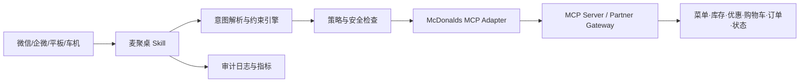
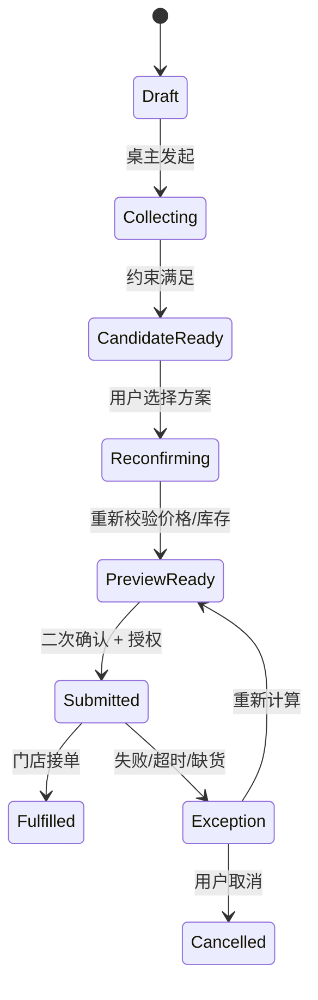
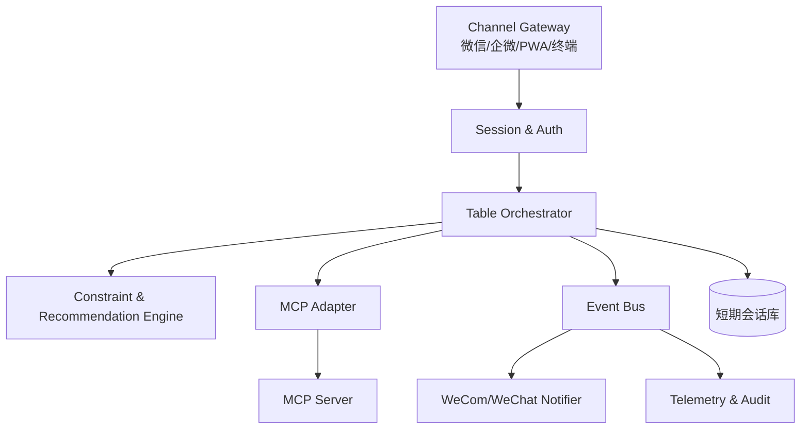

# 麦聚桌（Lunch Room OS）

## 基于麦当劳 MCP 的多人协同点餐 Skill 开发报告

> 一句话定义：把“群里问大家吃什么、反复确认、有人漏单、最后一个人垫付”的午餐流程，变成一个可在微信/企业微信里完成的协同点餐空间；每个人私密表达偏好，Skill 负责约束求解、套餐组合、优惠匹配、门店与时效判断，组织者一次确认后下单。

## 0. 给决策者的结论

建议首发 **麦聚桌**，并把产品拆成三个层级：

- **首发产品：多人协同点餐**。入口为微信群/企微群卡片，也可通过 H5 链接进入；MCP 负责门店、菜单、库存、价格、优惠、购物车、订单和状态查询/执行。
- **并行试点：麦声即取**。在门店平板、耳机或无障碍终端中，用一句话完成“预算 + 口味 + 取餐时间”的点餐，再通过屏幕、语音和灯光反馈取餐码。
- **二期产品：麦灵动午餐**。连接日历、地图 ETA、车机或桌面助手，在用户允许的前提下主动提出“到店即取 / 外送 / 预点”的午餐建议。

首发版本不依赖复杂硬件，能在已有微信、企业微信和移动网页上验证核心价值；同时，架构可以平滑接入不同的 MCP 服务版本和未来终端。

### 0.1 为什么这个创意值得做

多人点餐是高频、低容错的协作任务。传统群聊方案把“偏好收集、规则检查、付款、下单、追踪”全部交给人，导致四类浪费：

1. **沟通浪费**：同一个问题在群里重复问，成员不清楚是否已被记录。
2. **决策浪费**：预算、忌口、配送费、优惠券和取餐时间互相冲突，只能人工试错。
3. **执行浪费**：有人临时改餐、门店缺货、优惠失效，组织者需要重做订单。
4. **信任浪费**：代付、分摊、退款和取餐码分散在不同页面，容易出现漏单或误单。

麦聚桌把“聊天”改造成一个临时的、可审计的协作工作区，同时保留群聊的轻量入口。

### 0.2 成功标准（首个 8 周试点）

| 维度 | 目标 | 说明 |
|---|---:|---|
| 发起到最终确认 | P50 ≤ 90 秒 | 以 3–8 人工作餐为主要场景 |
| 成员完成填报 | ≥ 85% | 包含偏好、忌口、预算三项的成员占比 |
| 下单成功率 | ≥ 97% | 不含用户主动取消 |
| 漏单率 | ≤ 0.5% | 已确认清单与实际订单不一致 |
| 误单率 | ≤ 0.3% | 未经二次确认发生的商品/数量错误 |
| MCP 工具可用性 | ≥ 99.5% | 以查询类工具为主，执行类单独统计 |
| 试点复购 | ≥ 35% | 试点团队在 30 天内再次发起协同桌 |

以上是产品验收目标，不是麦当劳官方承诺；正式值应由业务方根据试点基线校准。

---

## 1. 产品设计

### 1.1 产品名与体验隐喻

**麦聚桌** 不是一个新聊天机器人，而是一张短时存在的“午餐桌”：

- **桌主**：创建桌、设定截止时间、确认最终方案，可选择代付或分摊。
- **桌员**：通过链接或群卡片加入，只看到自己的提交和必要的汇总信息；可私密填写过敏原、预算等敏感偏好。
- **桌面**：所有候选菜单、预算、时效和订单状态集中呈现。
- **桌签**：门店、取餐方式、预计可取时间、付款人和订单号。
- **桌钟**：显示距离截单还有多久，临近截止时只提醒未完成的人。

“桌”在下单确认后转为“取餐板”，展示每位成员的取餐状态，不把敏感偏好暴露在群里。

### 1.2 用户角色

| 角色 | 主要任务 | 关键权限 |
|---|---|---|
| 桌主/组织者 | 发起、设置约束、确认和付款 | 修改全局约束、触发下单、查看完整订单 |
| 桌员/参与者 | 提交个人需求、确认个人条目 | 修改自己的需求、查看自己的订单项 |
| 餐厅操作员 | 处理异常或人工协助 | 仅通过麦当劳既有运营系统处理，不直接接触群成员隐私 |
| 运营/客服 | 观察指标、处理投诉 | 脱敏查看审计事件和订单状态 |

### 1.3 三个核心模式

#### A. 快速拼桌（默认）

用户在群里点击“发起麦聚桌”，选择门店、取餐/配送、人数和截止时间。成员只需回答：

- 想吃什么或“不知道，帮我选”；
- 预算上限；
- 过敏原/饮食禁忌；
- 是否接受替换；
- 是否需要发票或餐具。

Skill 自动生成 2–3 个“可行桌面”：例如“预算优先”“时间优先”“口味覆盖优先”。桌主一次确认后进入支付和下单。

#### B. 智能拼盘（探索性）

把多人偏好视为一个约束优化问题：尽量满足硬约束，软约束则通过菜单替换、份量调整和优惠组合进行折中。输出必须解释“为什么这样组合”，避免用户感觉被黑箱决定。

#### C. 无障碍一句话点餐（麦声即取试点）

用户说：“两个人，50 元以内，一个不要辣，一个 10 分钟后取。”系统将语音转成结构化约束，屏幕显示大字卡片，同时读出商品和价格；写操作始终需要用户说“确认下单”或点击确认。

---

## 2. 关键用户旅程

### 2.1 工作日午餐（5 人，预算不一）

1. 桌主在企微群发送“发起麦聚桌”。Skill 获取群上下文中的门店候选，但不自动读取成员历史订单。
2. 桌主设置：人均 45 元、12:10 前可取、优先到店取餐、允许同类饮料替换。
3. 群内出现卡片：**加入麦聚桌｜还有 8 分钟截单｜点击填写**。
4. 每位桌员私聊/独立 H5 填写偏好；过敏原字段默认私密，仅显示“已处理”给桌主。
5. Skill 查询实时菜单、可售状态、门店服务方式和优惠，过滤不符合硬约束的候选。
6. 桌面显示三套方案：
   - **稳妥**：100% 满足硬约束，价格略高；
   - **省钱**：使用可用优惠，节省约 X 元；
   - **最快**：选择当前制作时间更短的可售组合。
7. 桌主查看差异和每个人条目，点击“确认这桌”。
8. 系统再次检查价格、库存、优惠和门店状态，生成订单预览；桌主确认付款方式后才调用下单工具。
9. 下单成功后，群内只发送总价、预计可取时间和“查看个人条目”链接；个人链接显示自己的商品和取餐码。
10. 任一商品缺货时，系统只重算受影响成员的替代项，保留其他人的选择，并在桌主确认后重试。

### 2.2 用户可见的解释模板

> 已找到 3 套可行方案。你设置的“无花生”是硬约束，所以候选中包含花生或无法确认配料的商品已排除。当前门店预计制作时间为 8–12 分钟；“省钱方案”使用了可用优惠，少 12 元，但有一位成员的饮料需从 A 换成 B。是否查看方案并确认？

解释中不得声称“绝对无过敏风险”。对于过敏原，必须提示以门店实际配料和交叉接触信息为准。

---

## 3. MCP 接入设计

### 3.1 先做能力发现，再做业务适配

由于不同麦当劳 MCP 服务可能采用不同工具名、字段名和授权方式，Skill 不应把模型直接绑定到某一版工具名。建议增加 **McDonalds MCP Adapter（适配层）**：



适配层启动时执行能力发现（例如 `tools/list` 或服务方提供的 capability endpoint），将实际工具映射到内部统一接口；若能力缺失，明确降级，而不是让模型猜测。

### 3.2 内部统一工具契约（Canonical Contract）

以下名称是本项目内部接口名，不代表麦当劳官方 MCP 方法名。真实接入时，在 Adapter 中做映射和字段校验。

| 内部方法 | 读/写 | 作用 | 关键输入 | 关键输出 |
|---|---|---|---|---|
| `store.search` | 读 | 查找附近/指定门店 | 经纬度、服务方式、营业时间 | 门店、距离、服务能力 |
| `menu.get` | 读 | 获取当前菜单 | `store_id`、渠道、地区 | 商品、规格、过敏原声明、可售状态 |
| `availability.check` | 读 | 校验库存与制作时间 | 商品清单、门店 | 缺货项、预计时间、限制 |
| `promotion.match` | 读 | 计算可用优惠 | 用户/桌、商品清单、渠道 | 优惠、适用条件、预计节省 |
| `cart.create` | 写 | 创建临时购物车 | 幂等键、门店、商品清单 | `cart_id`、价格快照、失效时间 |
| `cart.reprice` | 读/写 | 重新计价和重校验 | `cart_id`、版本号 | 最新价格、库存、优惠 |
| `order.preview` | 读 | 生成最终确认页 | 购物车、付款和履约方式 | 总价、明细、预计时间 |
| `order.submit` | 写 | 提交订单 | 预览版本、确认令牌、幂等键 | 订单号、支付动作、状态 |
| `order.status` | 读 | 查询制作/配送状态 | `order_id` | 状态、时间线、异常 |
| `order.cancel_or_refund` | 写 | 取消或发起退款 | 订单、原因、确认令牌 | 受理结果、预计到账 |

建议另外保留 `identity.link`、`payment.methods`、`receipt.create` 等可选能力；首发可先通过官方支付页或授权链接完成，避免在 Skill 中保存银行卡信息。

### 3.3 适配层的最小代码骨架

```ts
// canonical-contract.ts
export type OrderDraft = {
  storeId: string;
  fulfillment: "pickup" | "delivery";
  items: Array<{ sku: string; quantity: number; options?: Record<string, string> }>;
  constraints: {
    budgetMax?: number;
    allergens?: string[];
    deadlineAt?: string;
  };
};

export interface McdAdapter {
  discover(): Promise<CapabilityMap>;
  searchStores(input: StoreSearchInput): Promise<Store[]>;
  getMenu(input: MenuInput): Promise<MenuSnapshot>;
  checkAvailability(input: AvailabilityInput): Promise<AvailabilityResult>;
  matchPromotions(input: PromotionInput): Promise<PromotionResult>;
  createCart(input: OrderDraft, idemKey: string): Promise<CartSnapshot>;
  previewOrder(cartId: string, cartVersion: string): Promise<OrderPreview>;
  submitOrder(input: SubmitOrderInput): Promise<OrderResult>;
  getOrderStatus(orderId: string): Promise<OrderStatus>;
}
```

Adapter 必须具备：

- **幂等**：所有写操作携带 `Idempotency-Key`，重试不会产生重复订单；
- **版本校验**：购物车和价格使用版本号/时间戳，过期则重新预览；
- **结构化错误**：将缺货、区域限制、授权过期、超时、重复提交分开；
- **可观测性**：记录工具名、延迟、结果类型和关联 ID，日志中不写完整支付信息和敏感偏好；
- **版本隔离**：MCP 供应商更换工具名时只改 Adapter，不改 Skill 的对话逻辑。

### 3.4 写操作的确认门

任何可能改变订单、扣款、取消或退款的动作都必须经过以下状态机：



在 `PreviewReady` 页面明确展示：门店、取餐/配送方式、商品数量、优惠、总价、预计时间、付款人、取消规则。用户未点击“确认下单”时，Skill 只能查询和计算，不能调用 `order.submit`。

---

## 4. 约束求解与推荐逻辑

### 4.1 约束分类

- **硬约束**：过敏原规避、预算上限、门店服务方式、截止时间、数量上限。违反后不得推荐。
- **软约束**：偏好口味、品牌组合、热量目标、套餐完整度。可以打分排序。
- **可协商约束**：允许替换的饮料/配菜、预算可上浮金额、可接受的等待时间。系统需要提出清晰的交换条件。

### 4.2 评分示意

```text
candidate_score =
  0.35 * preference_fit
+ 0.25 * deadline_fit
+ 0.20 * budget_fit
+ 0.10 * promotion_saving
+ 0.10 * group_fairness
```

硬约束过滤在评分之前完成。`group_fairness` 用于避免系统为了总价最优而把某一个人的偏好长期牺牲；可采用“每位成员至少一项高匹配”的规则。

### 4.3 推荐结果必须可解释

每个候选方案至少包含：

```json
{
  "plan_id": "plan_20261023_001",
  "label": "省钱方案",
  "total_amount": 168.0,
  "estimated_ready_at": "2026-10-23T12:08:00+08:00",
  "hard_constraints_satisfied": true,
  "changes": [
    {"member": "成员A", "from": "饮料X", "to": "饮料Y", "reason": "使用桌级优惠"}
  ],
  "savings": 12.0,
  "tradeoffs": ["一位成员饮料发生替换"]
}
```

不能只返回“最优方案”，要返回至少一个稳定方案和一个有明确取舍的替代方案。

---

## 5. 微信、企微与多终端接入

### 5.1 微信/企业微信首发形态

**推荐链路：群卡片 → H5/小程序式桌面 → 授权/支付页 → 群状态回传**。

- 群卡片只包含桌名、截止时间、门店和状态，不包含个人过敏原、预算等敏感数据。
- 成员通过一次性短链接加入；链接绑定 `table_id + member_token`，不可猜测。
- 个人填写页与群汇总页分开；桌主可以看到“已完成/待完成”，不默认看到成员敏感字段。
- 下单后群里回传总价和进度，个人取餐码在私密页显示。
- 订单状态变化采用事件推送优先、轮询兜底，避免频繁刷群。

### 5.2 门店平板/自助机

首期不做复杂硬件，采用浏览器 PWA：

- 大字号、高对比度和屏幕朗读；
- 一句话输入 + 结构化确认卡；
- 支持扫码把桌面从手机接续到门店屏幕；
- 网络断开时只保留已加载的菜单浏览，禁止离线提交订单；
- 需要人工帮助时显示可读的桌号/会话码，不把个人手机号公开。

### 5.3 车机/桌面助手（二期）

用户可设置“工作日 11:30 提醒我午餐”，系统在用户授权后结合日历和位置提出建议。任何主动提醒都必须满足：

- 用户已明确开启提醒；
- 只在满足门店营业、可售和到达时间的情况下触发；
- 默认只给建议，不自动下单；
- 可一键关闭未来同类提醒。

---

## 6. 技术架构与数据模型

### 6.1 服务拆分



建议的最小服务：

1. `channel-gateway`：接收群卡片、H5、终端请求，统一用户会话。
2. `table-orchestrator`：管理桌状态、成员、截止时间和确认流程。
3. `constraint-engine`：解析硬/软/可协商约束，生成候选方案。
4. `mcd-adapter`：唯一接触麦当劳 MCP 的服务。
5. `notification-service`：群卡片、私信、短信或终端提示。
6. `audit-telemetry`：审计事件、指标、告警和脱敏日志。

### 6.2 核心数据表（示意）

```sql
CREATE TABLE lunch_table (
  id              VARCHAR(64) PRIMARY KEY,
  owner_user_id   VARCHAR(128) NOT NULL,
  channel         VARCHAR(32) NOT NULL,
  store_id        VARCHAR(128),
  fulfillment     VARCHAR(16),
  deadline_at     TIMESTAMP NOT NULL,
  status          VARCHAR(32) NOT NULL,
  version         INT NOT NULL DEFAULT 1,
  created_at      TIMESTAMP NOT NULL,
  updated_at      TIMESTAMP NOT NULL
);

CREATE TABLE table_member (
  table_id        VARCHAR(64) NOT NULL,
  member_id       VARCHAR(128) NOT NULL,
  display_name    VARCHAR(128),
  response_status VARCHAR(32) NOT NULL,
  private_blob    TEXT, -- 加密后的偏好与过敏原字段
  constraint_hash VARCHAR(128),
  PRIMARY KEY (table_id, member_id)
);

CREATE TABLE order_attempt (
  id              VARCHAR(64) PRIMARY KEY,
  table_id        VARCHAR(64) NOT NULL,
  provider_order  VARCHAR(128),
  idempotency_key VARCHAR(128) NOT NULL UNIQUE,
  cart_version    VARCHAR(128),
  total_amount    DECIMAL(10,2),
  status          VARCHAR(32) NOT NULL,
  error_code      VARCHAR(64),
  created_at      TIMESTAMP NOT NULL
);
```

实际项目中，敏感字段应使用密钥管理系统进行字段级加密；服务日志只保留哈希或分类标签。

### 6.3 API 草案

```http
POST /v1/tables
POST /v1/tables/{table_id}/members/join
PUT  /v1/tables/{table_id}/members/{member_id}/preferences
GET  /v1/tables/{table_id}/plans
POST /v1/tables/{table_id}/preview
POST /v1/tables/{table_id}/confirm
GET  /v1/tables/{table_id}/status
```

`POST /confirm` 的请求体必须携带：

```json
{
  "plan_id": "plan_20261023_001",
  "preview_version": "pv_9f2",
  "confirmation": {
    "user_id": "u_owner",
    "confirmed_at": "2026-10-23T11:58:12+08:00",
    "channel": "wecom_h5"
  },
  "idempotency_key": "table_abc_confirm_9f2"
}
```

---

## 7. 安全、隐私与食品信息边界

### 7.1 最小权限原则

- 桌员只访问自己的偏好和个人订单项；
- 桌主访问桌级方案、总价和必要的成员完成状态；
- Skill 不默认读取历史订单、通讯录、精确位置或支付卡号；
- 第三方渠道只获得完成当前订单所需的短期令牌；
- 订单执行权限与菜单查询权限分离，`order.submit` 单独授权。

### 7.2 过敏原与饮食禁忌

过敏原字段属于高敏感偏好，必须私密存储和最小化展示。推荐逻辑只做“根据已提供信息过滤/提示”，不能作医学保证：

> “系统依据当前菜单和门店提供的信息进行筛选；食品制作可能存在交叉接触，请在下单前查看门店最新配料与过敏原说明，并在需要时向门店确认。”

无法确认配料、库存或门店操作信息时，宁可把商品标为“无法确认”，也不要推断为安全。

### 7.3 审计与风控

所有写操作记录：操作者、桌 ID、预览版本、幂等键、工具调用结果、最终订单 ID 和错误码。禁止记录完整支付凭证、身份证件和未脱敏的过敏原文本。

高风险事件告警：

- 同一幂等键返回不同订单号；
- 价格在确认后变化超过设定阈值；
- 订单提交超时但供应商状态未知；
- 同一桌短时间连续提交多个订单；
- MCP 服务返回结构不符合 schema。

---

## 8. 异常、降级与客服策略

| 场景 | 用户可见行为 | 系统处理 |
|---|---|---|
| 菜单/库存查询超时 | 提示正在刷新，不给出过时的可售保证 | 退避重试；超过阈值转人工/官方下单页 |
| 某商品缺货 | 只展示受影响成员的替代选项 | 局部重算，不推翻整桌方案 |
| 价格或优惠变化 | 重新展示差异并要求再次确认 | 旧预览失效，禁止直接提交 |
| 下单响应超时 | 显示“正在确认订单”，禁止重复点击 | 查询订单状态；状态未知时进入人工核查 |
| 支付失败 | 保留购物车短时间，提供官方支付页重试 | 不自动更换付款人，不重复扣款 |
| 群卡片失效 | 可用短链接/扫码回到桌面 | 令牌过期需重新授权 |
| 终端断网 | 允许查看已缓存内容，禁止写操作 | 恢复网络后重新获取价格和库存 |

任何涉及订单状态未知的情况，优先查询再重试；不能用“重试下单”替代状态查询。

---

## 9. 开发计划与分工

### 阶段 0：能力核验（第 1 周）

- 获取麦当劳 MCP 的服务地址、认证方式、工具清单、地区与门店覆盖；
- 用 Adapter 完成 capability discovery 和 schema 校验；
- 确认菜单、库存、优惠、购物车、订单状态是否支持沙箱；
- 建立一份“官方字段 → 内部 canonical 字段”的映射表；
- 产出：接入清单、风险清单、沙箱冒烟报告。

### 阶段 1：单人闭环（第 2–3 周）

- 完成门店搜索、菜单查询、库存校验、购物车、预览、下单、状态查询；
- 完成二次确认、幂等、超时、状态未知处理；
- 产出：可审计的单人点餐 PWA 和 Adapter 集成测试。

### 阶段 2：多人协同 MVP（第 4–6 周）

- 完成桌状态、群卡片、成员私密填报、约束引擎、方案比较、代付/分摊入口；
- 支持 3–8 人、单门店、到店取餐；
- 产出：内部 3 个真实团队试点。

### 阶段 3：优惠、配送与异常优化（第 7–8 周）

- 接入配送方式、桌级优惠、局部替换、订单事件推送；
- 补齐客服工具、指标看板、灰度开关；
- 产出：对外小范围试点版本。

### 阶段 4：无障碍终端试点（第 9–12 周）

- 平板/PWA + 语音识别 + 大字卡片 + 取餐码；
- 在 1–2 家门店进行预约制测试；
- 产出：终端可用性报告和无障碍改进清单。

### 建议团队配置

- 产品经理 1：场景、业务规则、运营试点；
- AI/对话工程师 1–2：意图解析、约束抽取、解释文案；
- 后端工程师 2：Orchestrator、Adapter、订单状态；
- 前端/小程序工程师 1–2：H5、群卡片、桌面与取餐板；
- QA/安全 1：支付、幂等、隐私、异常注入；
- 麦当劳/渠道对接 1：MCP、授权、门店和客服流程。

---

## 10. 测试与验收

### 10.1 必测场景

- 3 人、8 人和 20 人桌规模；
- 多人同时修改偏好；
- 截止前 10 秒加入/退出；
- 菜单价格在预览后变化；
- 其中一项缺货，其他项保持不变；
- 下单接口超时但订单已创建；
- 幂等重试、网络重放、重复点击；
- 一位成员过敏原字段只在个人页面显示；
- 语音输入包含口语化否定、单位和时间表达；
- MCP 工具缺失、字段增加或返回 schema 错误。

### 10.2 验收口径

- **订单一致性**：最终订单逐项匹配桌主确认的预览版本；
- **支付安全**：任何测试重试不产生重复扣款或重复订单；
- **隐私隔离**：桌员无法通过 URL、接口或群卡片读取其他成员私密字段；
- **可解释性**：每个推荐方案都有价格、时效、替换和约束说明；
- **可恢复性**：异常订单可通过订单号和审计事件定位；
- **可用性**：主链路在移动端单手操作，关键按钮在首屏可见。

### 10.3 观测指标

技术指标：MCP 调用成功率、P50/P95 延迟、超时率、schema 错误率、重试次数、状态未知订单数。

业务指标：发起率、成员填报率、桌主确认率、下单转化率、平均订单金额、优惠使用率、复购率、客服介入率。

体验指标：从发起到确认耗时、改单次数、用户主动放弃点、推荐方案切换次数、满意度和“是否愿意再次使用”。

---

## 11. 演示脚本（10 分钟）

1. 在企微群点击“发起麦聚桌”，选择“公司园区门店、12:10 前取餐、每人 45 元”。
2. 三位成员分别提交：正常偏好、不要辣、对花生敏感；演示敏感字段在私密页中保存。
3. 点击“生成方案”，展示“稳妥 / 省钱 / 最快”三张方案卡。
4. 人为制造一项饮料缺货，展示局部替换和差异说明。
5. 桌主打开预览，确认总价、取餐时间、个人条目和优惠。
6. 点击“确认下单”，展示幂等键和订单状态事件（在演示环境中脱敏）。
7. 群内展示总价与取餐时间，成员私密页展示个人取餐码。
8. 模拟下单响应超时：系统先查询状态，不重复扣单。
9. 最后演示“麦声即取”：说“两个套餐，50 元内，一个不辣，十分钟后取”，屏幕显示结构化结果并要求确认。

演示应使用沙箱或模拟订单；不要在演示环境中使用真实支付卡信息。

---

## 12. 主要风险与取舍

| 风险 | 影响 | 应对 |
|---|---|---|
| MCP 能力覆盖不足 | 无法完成完整下单闭环 | 首期保留官方支付/下单页跳转；Adapter 做能力降级 |
| 菜单、库存和优惠实时性不足 | 推荐与实际不一致 | 预览前强制重校验，显示时间戳和失效原因 |
| 过敏原误解 | 食品安全和信任风险 | 只引用供应方信息，无法确认则不作安全结论 |
| 微信/企微渠道限制 | 群卡片和支付链路受限 | 使用 H5 短链和官方授权页面作为备用 |
| 多人协同规则过复杂 | 用户放弃填写 | 默认只问三项，更多约束放入“高级设置” |
| 组织者承担付款风险 | 结算纠纷 | 首期支持官方支付页和分摊记录，不在 Skill 内托管资金 |
| 订单状态未知 | 重复下单 | 状态查询优先、幂等键、人工核查队列 |

关键取舍是：先把“可靠地协同完成一次订单”做好，再逐步增加主动推荐、跨终端和营养化能力。创新点来自流程重构和约束协商，而不是把所有功能都塞进第一版。

---

## 13. 后续创新方向

### 13.1 团队口味记忆（可选加入）

在获得明确同意后，为团队保存“周三常用门店、预算区间、常见替换”这类群级偏好；成员个人过敏原和健康信息不自动沉淀为群画像。

### 13.2 “一桌一算法”优惠分配

当优惠不能同时覆盖所有成员时，系统给出透明的分配方案：谁获得套餐优惠、谁被替换、总共节省多少；成员可以查看自己的影响并提出反选。

### 13.3 取餐拥堵预测

结合订单状态和门店预计制作时间，在用户到达前给出“现在出发 / 延后 5 分钟 / 改配送”的建议。只做建议，不自行改变履约方式。

### 13.4 面向无障碍的多模态反馈

同一份订单状态同时以文字、语音、颜色和震动表达，确保视力、听力或注意力受限用户都能完成确认和取餐。

---

## 14. 立项前需要向麦当劳/渠道方确认的 12 个问题

1. MCP 服务是否提供正式的 capability discovery 和版本策略？
2. 是否有沙箱环境、测试门店和模拟支付？
3. 菜单、规格、营养和过敏原字段的权威来源与更新时间是什么？
4. 库存是实时、准实时还是下单时才校验？
5. 优惠是否支持桌级组合、用户级优惠和渠道限制？
6. 购物车、预览和订单提交是否支持幂等键？
7. 订单提交超时后，如何查询“已创建/未创建/未知”状态？
8. 是否支持事件推送，事件签名和重放策略是什么？
9. 支付由官方页面托管还是允许合作方发起？
10. 微信/企业微信场景是否有官方卡片、OAuth 和支付合规要求？
11. 订单取消、退款、发票和客服转接的标准接口是什么？
12. 允许展示哪些品牌、门店、商品和价格信息，缓存时长如何规定？

这些问题有答案后，才能把报告中的“内部统一契约”落成具体的 MCP 字段映射和上线清单。

---

## 附录 A：最小 MVP 范围

**必须有**：门店搜索、菜单查询、可售校验、3–8 人桌、私密偏好、方案对比、预览、二次确认、幂等下单、订单状态、群卡片和异常提示。

**可以后置**：配送、多门店比较、复杂会员权益、自动分摊、主动提醒、车机、语音终端、营养优化。

**明确不做**：代替医生进行过敏或健康判断；保存银行卡号；未经确认自动下单；在订单状态未知时盲目重试；把个人敏感偏好展示给群内其他人。

## 附录 B：一句话产品文案

> **麦聚桌：大家说需求，系统拼成一桌；你确认一次，麦当劳负责做好。**
